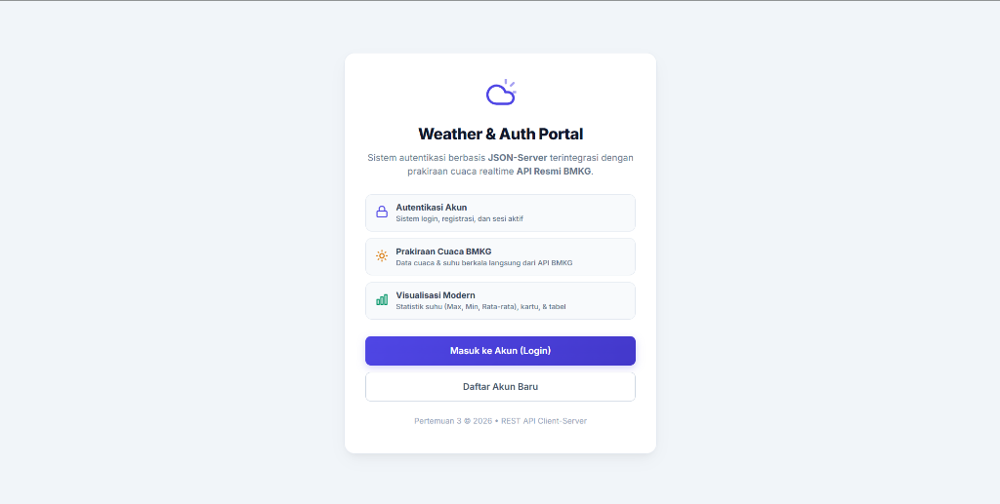
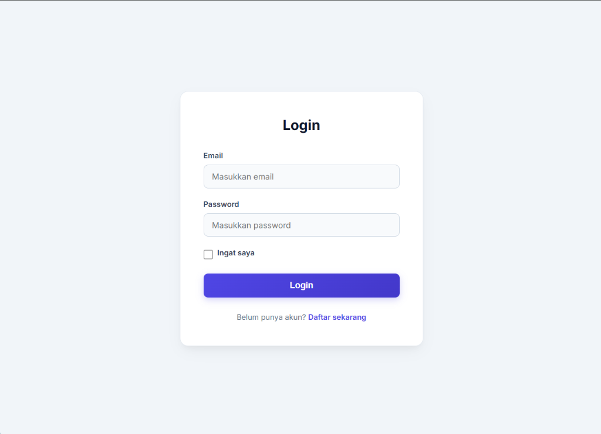
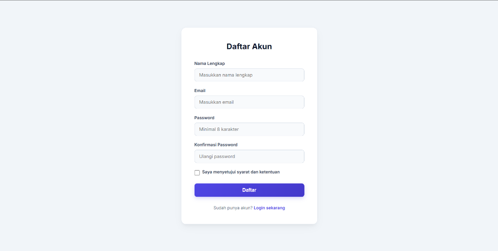
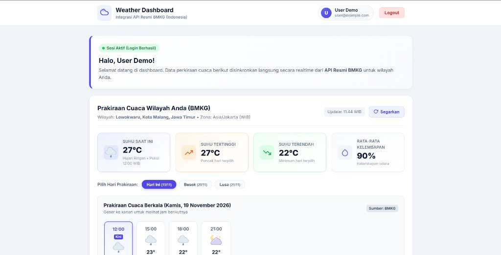

# Sistem Login & Registrasi dengan Mock API (json-server) & BMKG Weather API

Proyek ini menggunakan **json-server** sebagai Fake/Mock REST API untuk autentikasi dan **API Resmi BMKG (Badan Meteorologi, Klimatologi, dan Geofisika)** untuk menyajikan data prakiraan cuaca lokal secara realtime di dashboard setelah login.

---

## 🚀 Cara Menjalankan Server

Buka terminal pada folder proyek ini, lalu jalankan:

```bash
npm start
```
*(atau jika tanpa npm script: `npx json-server data/db.json -p 3000 -s .`)*

Server akan aktif di: **`http://localhost:3000`**

Akses halaman di browser:
- Portal Utama: `http://localhost:3000/`
- Login: `http://localhost:3000/login.html`
- Register: `http://localhost:3000/register.html`
- Dashboard: `http://localhost:3000/dashboard.html` *(akan otomatis diarahkan ke login jika belum login)*

---

## 📡 Endpoint REST API yang Digunakan

### 1. Autentikasi Pengguna (Local Mock API)
| Method | Endpoint | Fungsi | Keterangan |
| :--- | :--- | :--- | :--- |
| **GET** | `/users` | Ambil semua user | Menampilkan daftar akun |
| **GET** | `/users?email=...` | Cari user by email | Digunakan saat cek duplikasi email & login |
| **POST** | `/users` | Daftarkan user baru | Menambahkan data baru langsung ke `data/db.json` |

### 2. Prakiraan Cuaca Publik (BMKG Public API)
| Method | Endpoint | Keterangan |
| :--- | :--- | :--- |
| **GET** | `https://api.bmkg.go.id/publik/prakiraan-cuaca?adm4=35.73.05.1011` | Mengambil data prakiraan cuaca berkala resmi BMKG untuk wilayah Lowokwaru, Kota Malang, Jawa Timur. |

---

## 🌤️ Fitur Dashboard Cuaca

Setelah login berhasil, halaman dashboard menampilkan:
1. **Header Profil & Sesi Aktif**: Menampilkan nama pengguna, email, avatar inisial, status sesi, dan tombol Logout.
2. **Kartu Ringkasan Suhu**:
   - 🌡️ **Suhu Saat Ini**: Menampilkan pembacaan suhu pada jam saat ini.
   - 🔥 **Suhu Tertinggi (Max)**: Puncak suhu tertinggi untuk hari yang dipilih.
   - ❄️ **Suhu Terendah (Min)**: Nilai suhu terendah untuk hari yang dipilih.
   - 📊 **Rata-rata Suhu**: Perhitungan rata-rata suhu harian.
3. **Filter Tanggal (Date Pills)**: Pilihan tanggal interaktif (Hari Ini, Besok, dan 5 hari ke depan).
4. **Slider Kartu Per Jam (Hourly Cards Carousel)**: Kartu visual 24 jam dengan ikon kondisi, pembacaan derajat Celsius, dan indikator grafik batang mini. Jam saat ini ditandai dengan badge khusus.
5. **Tabel Data Detail (Toggle)**: Tabel interaktif yang menampilkan daftar lengkap jam, nilai suhu, label kondisi (Sangat Dingin, Dingin, Sejuk, Hangat, Panas), serta visual progress bar.
6. **Tombol Refresh**: Tombol "Segarkan" untuk mengambil ulang data terkini dari Open-Meteo API.

---

## 📸 Tangkapan Layar (Screenshots)

### 1. Portal Utama
<p align="center">
  
</p>

### 2. Halaman Login
<p align="center">
  
</p>

### 3. Halaman Registrasi (Daftar Akun)
<p align="center">
  
</p>

### 4. Dashboard Cuaca (Integrasi API BMKG)
<p align="center">
  
</p>

---

## 📁 Struktur File
- `screenshots/` : Berisi tangkapan layar aplikasi untuk dokumentasi.
- `data/db.json` : File database JSON utama yang dibaca & ditulis oleh `json-server`.
- `js/script.js` : Menangani proses autentikasi via `fetch()` dan pengambilan serta rendering data cuaca dari Open-Meteo API.
- `register.html` : Halaman form pendaftaran akun baru.
- `login.html` : Halaman form login akun.
- `dashboard.html` : Halaman dashboard profil pengguna dan visualisasi data Open-Meteo API.
- `css/style.css` : Tampilan antarmuka responsif dan modern.

---

## 🧪 Akun Demo Bawaan
- **Email**: `user@example.com`
- **Password**: `password123`
